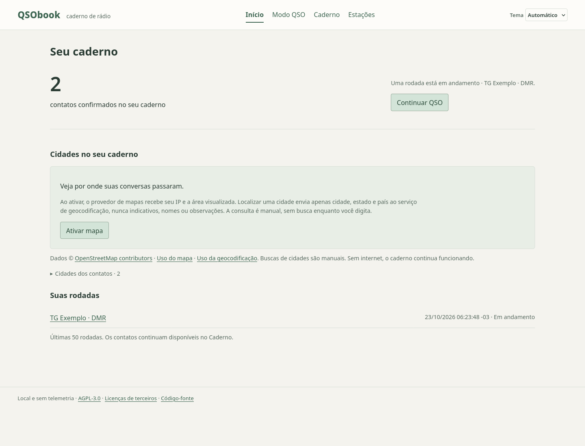
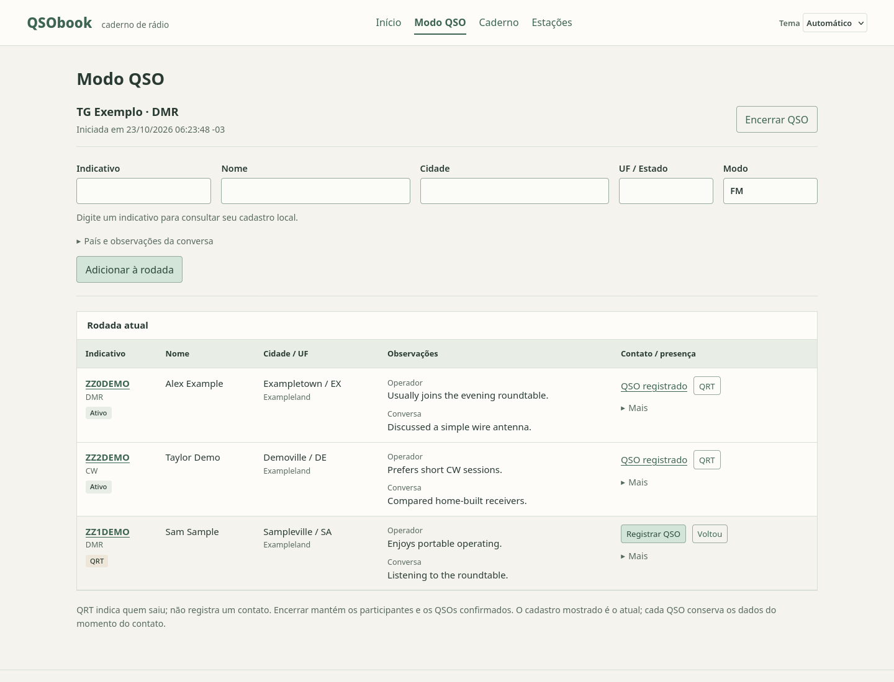
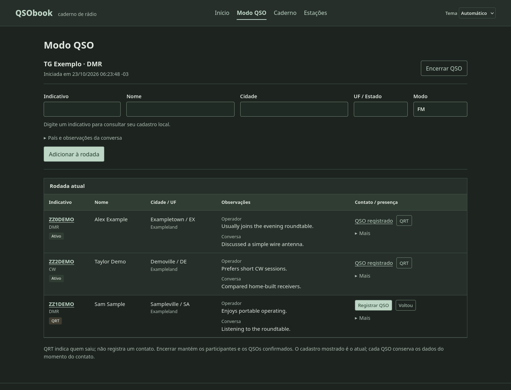
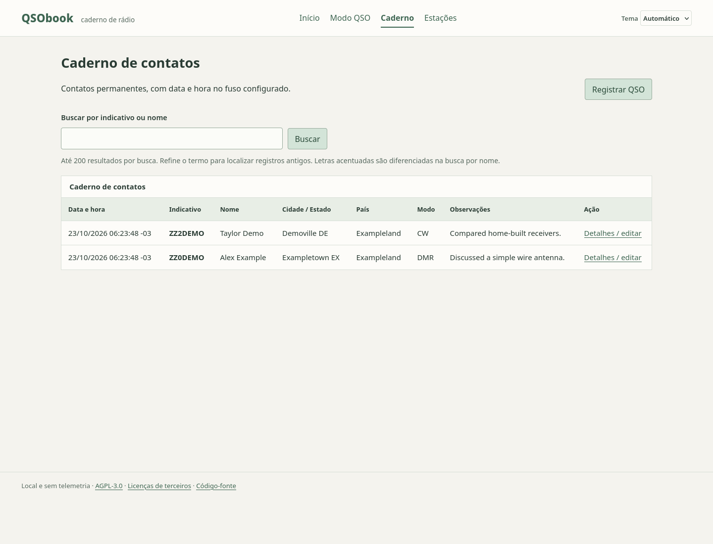
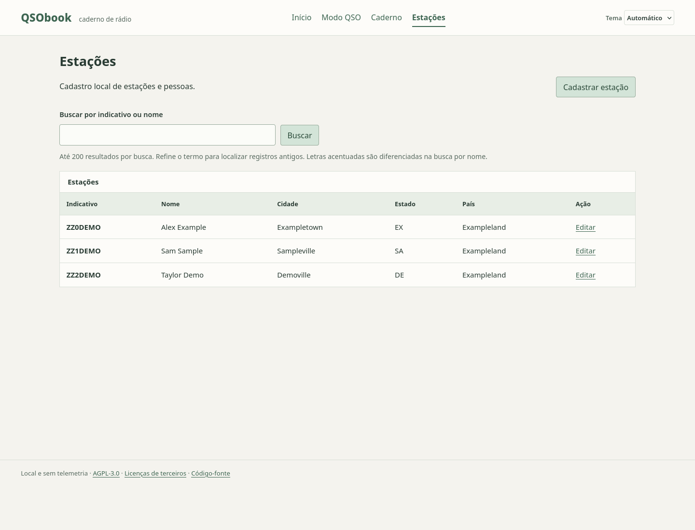
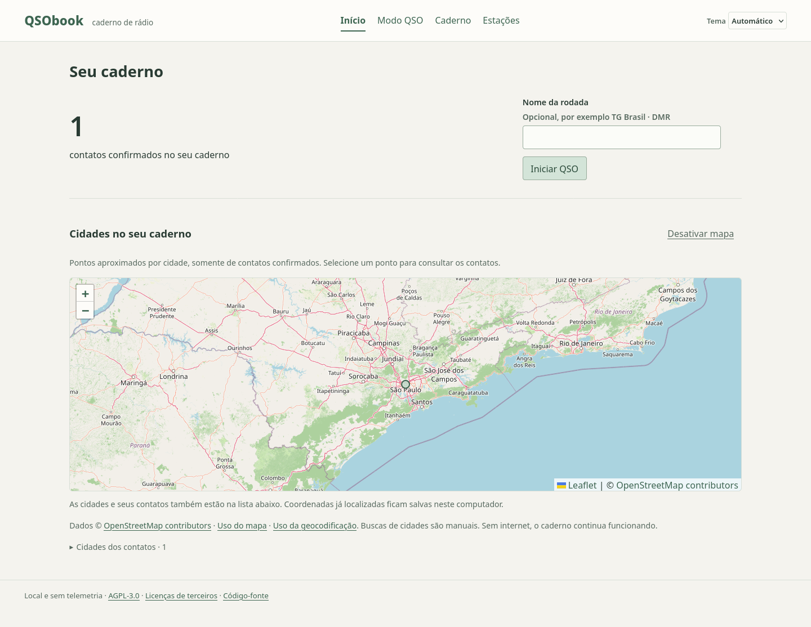

# QSObook

A small, free, self-hosted amateur radio notebook. Keep track of operators during a roundtable and record only the contacts you actually confirm.

Built with **Go, SQLite, HTML, CSS and plain JavaScript**, under [AGPL-3.0](LICENSE). No accounts, telemetry, analytics, CDNs or external callsign lookups. The notebook runs offline after compilation. The optional OpenStreetMap map requires internet only when enabled. The interface is currently in Brazilian Portuguese; this documentation is in English.

## A calm home screen

The home screen shows the number of confirmed contacts, an optional city map and a direct way to start or resume a roundtable. There are no timers, charts or extra dashboard indicators. **Modo QSO** opens the conversation workspace; **Caderno** opens confirmed history; **Estações** opens reusable operator records.



## QSO mode: follow the conversation

Choose **Iniciar QSO** (Start QSO), optionally name the roundtable, and add participants. The start action opens a roundtable; it does not confirm a contact. Only one roundtable can be open at a time, and it survives browser/server restarts.

Add a callsign, name and city without leaving the current roundtable. Known callsigns recover their operator details from the local database. The table puts callsign, name, city/state and notes first; mode and country stay secondary.



Screenshots use demonstration data with fictitious operators and callsigns. The example roundtable includes two confirmed contacts and one participant marked QRT without a confirmed contact. No personal database is included.

**Adding a participant does not record a QSO.** Click **Registrar QSO** (Record QSO) once you have actually made contact. Repeated or simultaneous confirmations create at most one QSO for that participation. Adding someone already in the list preserves their mode, conversation notes and confirmation status.

Use **Mais → Editar** (More → Edit) to open an editor in the table. Country and conversation notes are available in an expandable section. Without JavaScript, the same edit link opens a separate page and the forms remain usable.

Click **QRT** when someone leaves. They remain in the table, after active participants; **Voltou** (Returned) makes them active again. Neither action records a QSO or resets its confirmation. **Encerrar QSO** (End QSO) closes the roundtable and preserves participants, notes and confirmed contacts. Closed roundtables can be consulted from the home screen and cannot be changed through old forms.

The current roundtable is shared by browser tabs. Removing someone from the list retains their participation in storage, operator record and confirmed contacts. A new roundtable reuses known operators with a fresh participation and an independent confirmation. For an additional contact within the same roundtable, remove and add the operator again. Participation IDs are never reused; old actions cannot reach the new participation. Start and end actions also handle repeated submissions safely.

## Light and dark, without clutter

A muted pastel palette, clear typography and compact controls keep the conversation table central. Choose **Claro** (Light), **Escuro** (Dark) or **Automático** (System) using the theme selector. The preference stays in the current browser, without an account or network request. If browser storage is blocked, switching still works for the current page.



## Local callsign lookup and safe notes

Typing a known callsign retrieves the operator name, city, state and country, plus the number of earlier QSOs. No callsign data is sent to an external service. Lookups ignore stale responses, including A → B → A changes, and preserve edits made while a request is pending. Drafts remain separate by callsign while the page is open. Clearing the callsign clears the previous operator fields.

New participant, manual QSO and operator registration forms preserve fields already saved for a known callsign and only fill missing values. To replace existing data, use **Editar**. Empty fields in a conversation edit preserve the current registration. To intentionally clear an operator field, use **Estações → Editar** (Stations → Edit).

- **Operator notes** are permanent and edited in Stations.
- **Conversation notes** belong to a participation and are copied into the QSO when it is confirmed. They never replace permanent operator notes.
- Each QSO keeps its own historical copy. Later operator or participation edits do not change earlier contacts. Editing a QSO changes only that contact; its callsign and timestamp stay fixed.

Explicit edits in different tabs still use the last saved values; there is no edit-version conflict detection. Reload a record before editing it if another tab has changed it. A manual QSO submission is intentionally a new contact each time.

## Notebook: confirmed contacts

The **Caderno** (Notebook) lists confirmed contacts with their automatic date/time, mode and conversation notes. Search by callsign or name, open contact details or register a contact manually. Clicking a callsign in QSO mode opens its history search.



Timestamps are stored in UTC and displayed in the configured time zone. Searches return up to 200 records, with the newest contacts first. Name searches ignore ASCII letter case but distinguish accented characters; refine the term to find older records.

## Operators: reusable local records

The **Estações** (Stations) page keeps operator details separate from contact history. Callsigns are unique and normalized to uppercase. Edit names, locations and permanent notes here without rewriting past contacts.



## Optional map of confirmed contacts

Enable the map explicitly on the home screen. It groups **confirmed QSO locations**, using the historical city/state/country from each contact rather than a later operator registration edit. Each point represents an approximate city location; selecting it opens the contacts for that city. Contacts without a city are counted in the total but have no map point. The city list and history remain usable offline and without JavaScript.

Expand the city list and choose **Localizar cidade** (Locate city) once for each unmapped city. This sends only the saved city, state and country to the configured geocoder. Callsigns, names and notes stay local. Coordinates and not-found results are cached in SQLite, so reopening the map or repeating a submission does not repeat the lookup. A cached not-found result currently has no retry/reset editor; check the contact location before the first lookup.



The default providers are OpenStreetMap tiles and Nominatim. Enabling the map permits the tile provider to receive the browser IP, viewed area, browser headers and the application origin as its Referer. The geocoder sees the server IP and geographic query. Disabling the map removes it on reload, blocks new geocoding requests and retains cached coordinates. Reload any other already-open map tabs as well. The preference applies to this local notebook and its browser tabs.

Follow the [Nominatim usage policy](https://operations.osmfoundation.org/policies/nominatim/): deliberate user-triggered searches only, no autocomplete or periodic batch work, an identifying User-Agent, local caching and at most one request per second. QSObook serializes requests through a database lease, enforces a gap after completion, bounds provider timeouts and respects retry delays. Operators running multiple independent instances must consider their combined usage and switch providers if required. The [tile policy](https://operations.osmfoundation.org/policies/tiles/) requires attribution, normal viewport use and normal HTTP caching; no bulk/offline tile download is offered. Provider availability is not guaranteed.

Provider URLs can be changed without updating the application, for example to use self-hosted services:

```sh
./bin/qsobook -map-tiles-url 'https://tiles.example.org/{z}/{x}/{y}.png' -geocoder-url 'https://geo.example.org/search'
```

Tiles must be compatible with Leaflet's XYZ format and geocoding must accept Nominatim's structured query and JSON format. URLs require HTTPS, with HTTP allowed for loopback services. Review a provider's privacy and usage terms before enabling it. Leaflet 1.9.4 and its assets are embedded locally under BSD-2-Clause; no runtime CDN, npm toolchain or Leaflet plugin is used.

## Build

Requires **Go 1.24.4 or compatible**. SQLite, a C compiler and frontend build tools are not required. The module path and declared Go version are unchanged.

The first build downloads the pinned Go modules. The resulting executable embeds templates, styles, scripts, time-zone data and license notices, and runs offline.

```sh
go mod download
CGO_ENABLED=0 go build -o bin/qsobook .
```

These commands also build natively on Linux ARM64, including Raspberry Pi with Debian. To cross-compile from another computer:

```sh
CGO_ENABLED=0 GOOS=linux GOARCH=arm64 go build -o bin/qsobook-linux-arm64 .
```

Cross-compilation does not replace testing on the target hardware. The current changes have been tested on Linux AMD64 with Go 1.27.3, with CGO disabled, and cross-compiled for ARM64. Running this revision on a Raspberry Pi remains pending.

## Run locally

```sh
./bin/qsobook
```

Open **http://127.0.0.1:8080** on the same computer. Stop with `Ctrl+C`. The application runs in the foreground and installs no system service.

The default database is `$XDG_DATA_HOME/qsobook/qsobook.db`, or `$HOME/.local/share/qsobook/qsobook.db` when `XDG_DATA_HOME` is unset. The directory is created as needed. Keep real data outside the source tree and static assets.

Choose another database, loopback port and time zone with:

```sh
./bin/qsobook -db "$HOME/.local/share/qsobook/my-notebook.db" -addr 127.0.0.1:8081 -timezone America/Sao_Paulo
```

The default time zone is `America/Sao_Paulo`; use `-timezone UTC` for UTC display. Time comes from the host clock, without an external time service. The `-addr` flag accepts loopback IPs only. There is no authentication: this version assumes trusted local users. Do not expose it to the internet or add a proxy/LAN access before defining authentication, TLS and the access model. See [SECURITY.md](SECURITY.md).

## Upgrading and preserving data

Stop the application and every other process using its database before making a manual copy. Preserve any SQLite journal files. Do not copy only the `.db` file while it is in use. Test a copy at a separate path before relying on it.

Database migrations run in a transaction and retain operator, contact and participation records. Schema version 4 includes persistent non-reusable participation IDs, named roundtables, presence status, optional map preferences and cached city coordinates. The previous live list becomes “Rodada anterior” during migration, retaining IDs and QSO links; an empty database waits for an explicit start. Databases with a newer schema are rejected; downgrades are not automatic. Make a stopped-database copy before upgrading.

There is no in-app backup/restore, import/export or ADIF feature yet. The application does not permanently delete operators or QSOs. See the [roadmap](docs/ROADMAP.md).

## Tests

```sh
CGO_ENABLED=0 go test ./...
CGO_ENABLED=0 go vet ./...
git diff --check
```

Tests use temporary databases and fictitious data. They cover persistence, validation, historical snapshots, independent notes, rollback, concurrent confirmation, callsign reuse, round lifecycle/QRT, stale actions, map opt-in, geographic-only requests, local/negative caches, rate limits, provider failures, HTTP security and migrations from earlier schemas. Automated map tests use local HTTP providers, never public geocoding services. Migration tests verify that records and links survive, failures roll back and removed participation IDs stay unused after reopening the database.

JavaScript tests optionally use Node.js and its built-in test runner:

```sh
node --test tests/*.test.cjs
```

No npm packages are required. The tests run lookup/form behavior against a simulated DOM with controlled requests and timers, and verify theme persistence, system changes and unavailable browser storage. They do not replace real browser testing.

To keep development caches and temporary files inside the repository:

```sh
mkdir -p .cache/go-build .cache/go-mod .cache/tmp
export GOCACHE="$PWD/.cache/go-build"
export GOMODCACHE="$PWD/.cache/go-mod"
export GOTMPDIR="$PWD/.cache/tmp"
export TMPDIR="$PWD/.cache/tmp"
```

The UI uses labels, visible keyboard focus, responsive forms and horizontal scrolling confined to the participant table. Desktop layout, local lookup, theme selection/persistence and phone/tablet widths have been checked in the browser. A real geographic-only Nominatim request, loaded OpenStreetMap tiles, a city marker and its filtered-history link were also checked with fictitious contact data. POSTs in the integrated browser were blocked by its mediated origin; writes were checked through HTTP tests and valid-origin local requests. Full testing on a physical phone and with assistive technology remains pending. Security controls were kept in place.

## Manual QSO checklist

Use a separate database for fictitious test records:

```sh
./bin/qsobook -db .cache/manual-test.db -addr 127.0.0.1:8081
```

1. Open `http://127.0.0.1:8081`, choose **Iniciar QSO**, optionally name the roundtable and start it. Add `ZZ0TEST`, a name and city. The participant should appear in QSO mode without a new contact in the Notebook.
2. Use **Mais → Editar**, expand the conversation notes section, add a note and save in place.
3. In Stations, save a different permanent operator note. QSO mode should label the permanent and conversation notes separately.
4. Enter `zz0test` again. Name and location should fill locally while conversation notes stay empty. An immediate submission, empty fields or a stale inclusion form must not replace saved operator data or duplicate the participation.
5. Click **Registrar QSO**. Check for one contact in the Notebook with the conversation note. Reloading must not create another QSO.
6. Edit the operator and roundtable notes. The confirmed contact should keep its historical values.
7. Switch rapidly between callsigns and clear the callsign field. Check that drafts and asynchronous responses never mix operators.
8. In a second tab, keep an old record/remove form open. Remove that participant and add another in the first tab. The old action should return not found and leave the new participant untouched.
9. Mark a participant **QRT**, then **Voltou**. Confirm that presence changes without a new QSO. End the roundtable, consult it from the home screen and start a new one with the same operator. The old roundtable and contacts should remain intact.
10. Choose light, dark and system themes, then navigate/reload. Stop and restart with the same database. Check persistence, keyboard navigation and the fallback without JavaScript.
11. The map starts disabled. Enable it after reading the disclosure, locate a city with a confirmed contact, reload and open its marker/history. Disable it and confirm the local notebook remains usable without map requests. Public providers must only be exercised manually and sparingly; use fake local providers for automated tests.

## Structure and maintenance

```text
main.go                 configuration and HTTP lifecycle
store.go                SQLite operations and validation
rounds.go               saved roundtables, presence and lifecycle
map.go                  optional providers and local coordinate cache
web_rounds.go           home screen and roundtable HTTP workflows
web.go                  routes, templates and HTTP protection
store_test.go           persistence and data integrity tests
migration_test.go       migration preservation and rollback tests
web_test.go             HTTP workflows and security tests
rounds_test.go          lifecycle, QRT and migration regressions
map_test.go             privacy, cache and provider-failure regressions
tests/*.test.cjs        JavaScript regressions using built-in modules
migrations/             versioned SQL schema
templates/              HTML interface
static/                 local CSS and JavaScript
docs/                   architecture, roadmap and screenshots
```

The only direct Go dependency is `modernc.org/sqlite v1.36.3`, a BSD-3-Clause SQLite driver without CGO. Transitive dependencies are pinned in `go.mod`/`go.sum`. See [architecture](docs/ARCHITECTURE.md), [CONTRIBUTING.md](CONTRIBUTING.md) and [AGENTS.md](AGENTS.md). Changes use maintainer review; the application itself does not perform Git operations.

## License

GNU Affero General Public License, version 3: the full text is in [LICENSE](LICENSE). The official project is free of charge; the license permits commercial redistribution without additional restrictions. The footer links to the license, third-party notices and source repository. Modified versions offered over a network must provide their corresponding source as required by the AGPL.
