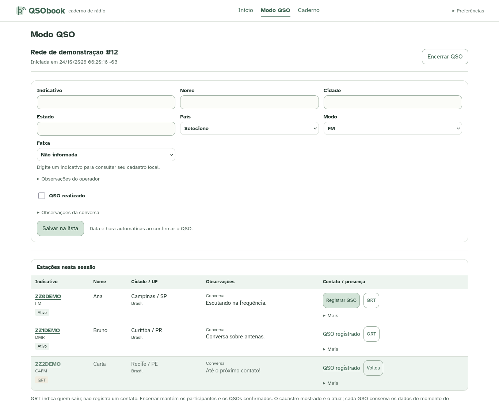
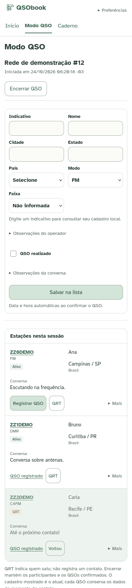
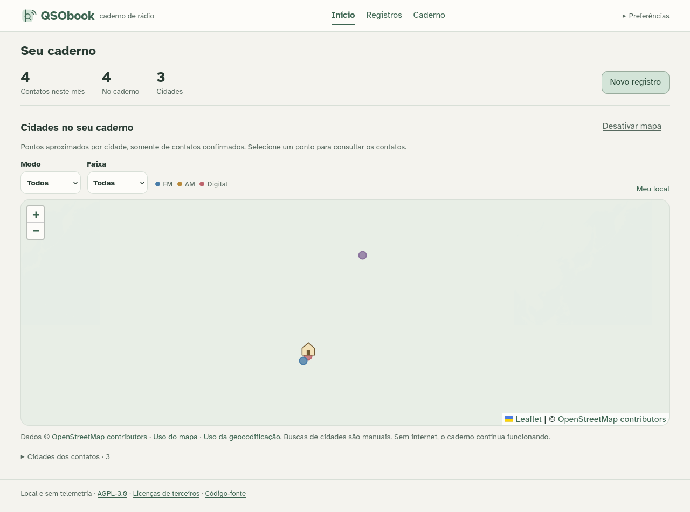
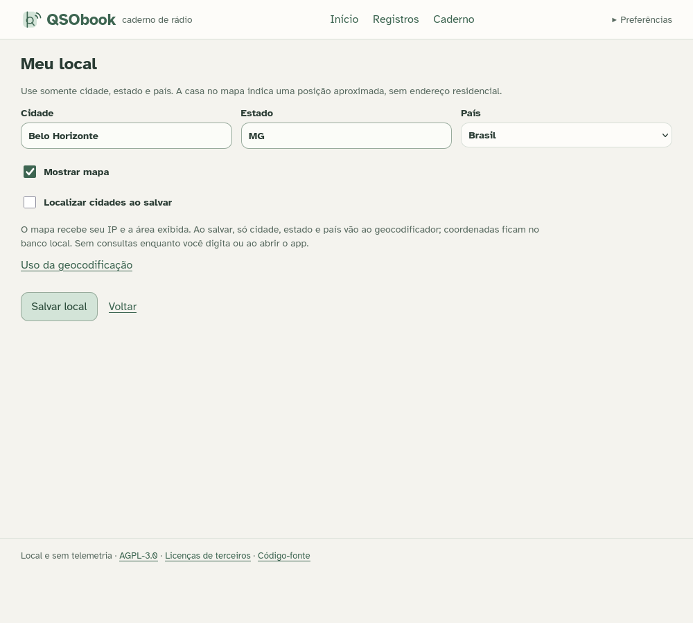
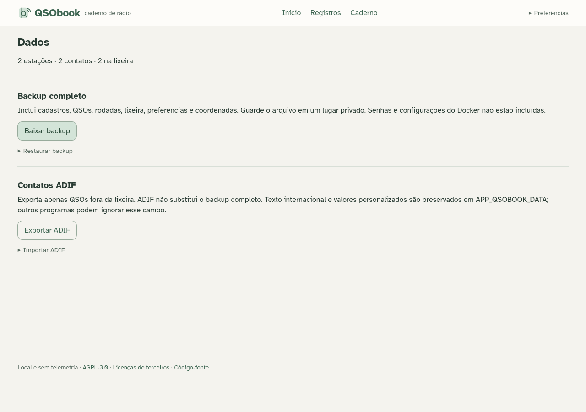
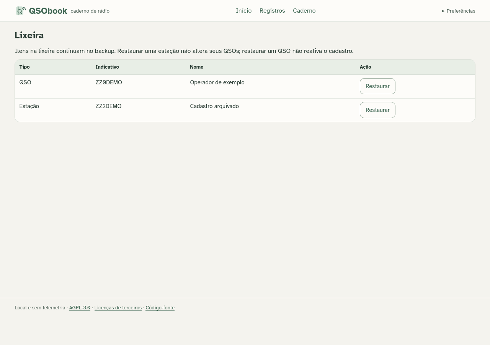
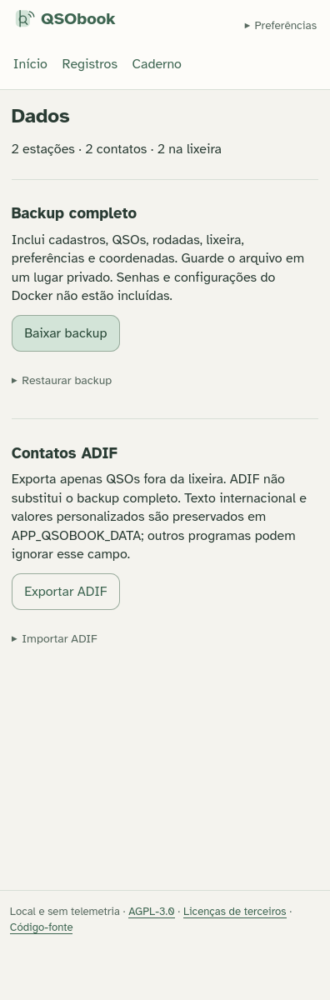

# QSObook


[](https://github.com/erickfaria/QSObook/actions/workflows/ci.yml)

A small, free, self-hosted amateur radio notebook. Register an operator and confirm a contact on one compact screen; roundtables are optional.

Built with **Go, SQLite, HTML, CSS and plain JavaScript**, under [AGPL-3.0](LICENSE). No accounts, telemetry, analytics, CDNs or external callsign lookups. The notebook runs offline after compilation. The optional OpenStreetMap map requires internet only when enabled. Choose Portuguese, English, Spanish or French in the interface. Project documentation is in English. [Release notes](docs/RELEASE_NOTES.md) describe the stable version. Start with the [Wiki](https://github.com/erickfaria/QSObook/wiki) or [installation guide](docs/INSTALL.md).

## One QSO workspace

Open **Modo QSO** (QSO mode) in the main navigation. Choose whether you are in a roundtable and press **Começar** (Start). Leave the checkbox off for an ordinary listening session. A roundtable can have a name and optional numeric edition; the last name and edition are remembered locally for the next session. Change only the edition when needed. Remembering a name never selects the roundtable checkbox automatically.

Enter a callsign and fill in the operator's details. Existing callsigns retrieve name, city, state, country and permanent notes entirely from SQLite. Country is a local dropdown with no default, and existing free-text values remain usable. Choose a mode and optional band; custom values are supported.

**QSO realizado** (QSO completed) starts unchecked. **Salvar na lista** (Save to list) registers the operator and adds them to the live list without creating a contact. Check the confirmation box when you have actually had a conversation, or use the list's one-click **Registrar QSO** action later. The confirmation time is automatic. Listening/conversation notes stay with the participant until confirmation; permanent operator notes remain separate.



**QRT** saves who has left, dims that row and moves it below the active stations. **Voltou** (Returned) brings the station back. Ending the session preserves participants, presence state and confirmed contacts; it never confirms pending participants. Previous sessions are available in QSO mode, without a duplicate entry panel on the dashboard.

Confirmation is transactional. Retrying the same form or clicking repeatedly produces one contact for that participation, preserving its snapshot and any newer registration. A key reused for another callsign is rejected. Adding an existing participant preserves their saved mode, notes and QRT state; use **More → Edit** to revise the listening draft before confirmation. To intentionally record another conversation in the same session, remove and add that station again. New sessions create independent participations.

New entries only complete missing registration fields. Use **Edit registrations** to replace saved values or permanent notes. Operator edits never rewrite historical contact snapshots. The former `/records` page opens this same workspace; legacy POST endpoints remain compatible.

## Compact on a phone

A white light theme with restrained pastel accents, a dark theme, two-column entry, rounded controls, 44px mobile touch targets and scrollable tables keep the page focused. Light, dark and system themes remain available under Preferences, along with Portuguese, English, Spanish and French. Contact data is not sent to translation services or saved in browser storage.



The original SVG logo and home marker are project artwork. **Atkinson Hyperlegible**, bundled locally in regular and bold under SIL OFL 1.1, supplies application and map-control typography. Both font files total about 47 KB. There are no remote font requests, proprietary font files or new runtime packages. Country labels are embedded Unicode CLDR data under Unicode License V3; no country table is added to SQLite. Sources, pinned revisions and licenses are in [third-party notices](docs/THIRD_PARTY_NOTICES.txt).

## A small home screen and a cached map

The home screen shows confirmed contacts for the current calendar month in the configured time zone, the notebook total and the number of recorded cities. **Entrar no Modo QSO** opens the single live workspace. The optional map groups confirmed historical contact locations; later operator edits do not move earlier contacts.



Open **Preferências → Meu local**, save your city, state and country, and explicitly enable the map and **Localizar cidades ao salvar** if wanted. No street address or device GPS is requested. Once located, your approximate city appears as a small house. After enabling, the map draws saved points whenever the home screen opens; it does not geocode them again.

Saving a confirmed record can locate its city automatically after the contact transaction commits. The service receives **only city, state and country**, never callsigns, operator names or notes. Coordinates and no-match results stay in the existing local SQLite cache. A failed/offline/busy provider leaves the contact saved and reports a pending location; use the city list's **Localizar cidade** action later. Existing unmapped historical cities are not geocoded in a startup batch.

FM markers are blue, AM amber and digital modes red (DMR, EchoLink, D-Star and C4FM). SSB/CW have separate muted colors; mixed cities are neutral until filtered. Mode and band filters run locally. Selecting a point opens the matching city history; the house remains visible while filtering. Tiles need internet; the notebook, history, local lookup and stored coordinates remain available offline.

The [Nominatim usage policy](https://operations.osmfoundation.org/policies/nominatim/) requires user-triggered queries, application identification, attribution, caching and at most one request per second. There is **no external autocomplete, background batch, periodic geocoding or retry loop**. A database lease and cooldown serialize requests; saving quickly can leave a city pending. Independent instances must manage their aggregate provider usage. Map tiles follow the [OSM tile policy](https://operations.osmfoundation.org/policies/tiles/), without scraping, prefetching or offline downloads. Providers can be changed with deployment flags.

## History and optional roundtables

**Caderno** (Notebook) lists confirmed contacts, automatic date/time, mode, band, optional roundtable name and conversation notes. Search by callsign/name or open a city/mode/band selection from the map. Dates are stored in UTC and displayed in the configured time zone. Stations and Notebook show 50 results per page with previous/next links. Search includes callsign, name and city, ignoring common Latin accents; Notebook adds an inclusive date range in the configured time zone.

QSO mode is a primary navigation item. Existing rounds, participants, QRT state, notes, IDs and contact links remain intact. Closed sessions are read-only and display current registrations; each confirmed QSO retains its historical snapshot. The workspace lists the latest 50 sessions. Station and Notebook searches show 50 results per page.

Screenshots use fictitious operators and demonstration contacts only. Explicit concurrent edits still use the last saved values. Replay protection applies to QSO entry and participant confirmation; older direct `POST /contact` clients retain their previous new-contact semantics.



## Keep and recover your notebook

**Preferences → Data** downloads a consistent SQLite `.db` backup while the app is running. Restore validates a separately staged file and shows a preview before you confirm replacement of the whole notebook. It preserves a validated pre-restore recovery copy first, replaces related data atomically and expires old forms. Backups include the trash, preferences and coordinate cache; Docker settings and password files stay separate. Uploaded backups are limited to 64 MiB and exact schema versions 5 through 7. Keep a private offline copy outside the Pi.



**Delete QSO** and **Delete station** are available from the relevant edit page, with a confirmation screen. QSOs in the trash are excluded from history, totals and map points. Deleting a station preserves its contacts and reserves the callsign until restored. Restore items under **Preferences → Trash**. There is no permanent purge or automatic expiry of trashed records.



ADIF export covers every non-trashed QSO. Import previews new contacts, duplicates and unsupported fields before an atomic confirmation. It accepts ASCII ADI up to 16 MiB/10,000 records, skips matching callsign/UTC-second/mode/band identities (including trashed contacts), preserves current registrations and does not geocode imported cities. Unicode and custom values from QSObook exports survive through an application-defined field; other software may ignore it. ADX and non-ASCII ADI are not supported. ADIF is a contact interchange format, not a full backup. See the [data guide](docs/DATA.md) for field mapping and limitations.



Correct a map point through the city's **Correct location** link or **My location**. Coordinates can be saved offline; an explicit provider retry also works for no-match caches, obeys cooldowns and preserves an existing point if the provider fails. These actions never change historical location text. **Preferences → About** shows the installed app/source/schema version and update links, without checking the internet automatically.

## Stable release and ready-made image

**v0.1.0** is the first stable release. The release workflow publishes tested Linux ARM64/AMD64 images to **GitHub Container Registry**, with digest-pinned Compose downloads and provenance attestations. No Docker Hub account or local compilation is needed. See the [installation guide](docs/INSTALL.md) for v0.1.0 release files, Tortuga/private-LAN or VPN access with an optional password, backups and manual updates. A new GitHub commit does not automatically deploy to your server.

The network option is for a trusted home LAN; HTTP does not encrypt traffic. Use HTTPS/VPN for untrusted networks or internet access. Standalone/local-only defaults remain unchanged. Do not expose the unauthenticated local configuration.

## Docker Compose from source

You can build and run locally without publishing an image or creating a Docker Hub account. Install Docker Engine and the Compose plugin first, then from this repository:

```sh
docker compose up -d --build
```

Open **http://127.0.0.1:8080**. SQLite stays in the named `qsobook_data` volume when the container is recreated. `docker compose stop` stops the app; `docker compose start` resumes it. Never delete the data volume or use `down -v` to update.

Read the [step-by-step Docker guide](docs/DOCKER.md) for prerequisites, Raspberry Pi, local ports, offline backups, updates and troubleshooting. The default container deployment remains local-only. It does not automatically import your standalone notebook or enable direct LAN/phone access.

## Build

Requires **Go 1.24.4 or compatible**. SQLite, a C compiler and frontend build tools are not required. The module path and declared Go version are unchanged.

The first build downloads the pinned Go modules. The resulting executable embeds templates, styles, scripts, time-zone data and license notices, and runs offline.

```sh
go mod download
CGO_ENABLED=0 go build -o bin/qsobook .
```

These commands also build natively on Linux ARM64, including Raspberry Pi with Debian. To cross-compile from another computer:

```sh
CGO_ENABLED=0 GOOS=linux GOARCH=arm64 go build -o bin/qsobook-linux-arm64 .
```

Cross-compilation does not replace target-hardware testing. Release checks run natively on hosted Linux AMD64 and ARM64, including containers. The maintainer reported successful beta-5 use on a Raspberry Pi; verify each updated deployment manually.

## Run locally

```sh
./bin/qsobook
```

Open **http://127.0.0.1:8080** on the same computer. Stop with `Ctrl+C`. The application runs in the foreground and installs no system service.

The default database is `$XDG_DATA_HOME/qsobook/qsobook.db`, or `$HOME/.local/share/qsobook/qsobook.db` when `XDG_DATA_HOME` is unset. The directory is created as needed. Keep real data outside the source tree and static assets.

Choose another database, loopback port and time zone with:

```sh
./bin/qsobook -db "$HOME/.local/share/qsobook/my-notebook.db" -addr 127.0.0.1:8081 -timezone America/Sao_Paulo
```

The default time zone is `America/Sao_Paulo`; use `-timezone UTC` for UTC display. Time comes from the host clock, without an external time service. In standalone mode, `-addr` accepts loopback IPs only. The explicit `-container` flag additionally permits `0.0.0.0` inside the container network; the supplied Compose file publishes only on host loopback. Host, Origin and CSRF restrictions stay in place. Local-only mode assumes trusted local users. Private-LAN/VPN access requires explicit allowed host:port entries; a shared password file is optional; see the [installation guide](docs/INSTALL.md). Without a password, network/VPN rules control access. Do not expose it to the internet. See [SECURITY.md](SECURITY.md).

## Upgrading and preserving data

Stop the application and every other process using its database before making a manual copy. Preserve any SQLite journal files. Do not copy only the `.db` file while it is in use. Test a copy at a separate path before relying on it.

Database migrations run in a transaction and retain operator, contact and participation records. Schema version 7 adds optional round editions and remembered round names to the recoverable deletion, band/round-label and map settings schema, retaining persistent participation IDs, roundtables, presence status and cached coordinates. The previous live list becomes “Rodada anterior” during migration, retaining IDs and QSO links; an empty database waits for an explicit start. Databases with a newer schema are rejected; downgrades are not automatic. Make a stopped-database copy before upgrading.

Open **Preferences → Data** for consistent SQLite backups, validated restoration and ADIF contact transfer. **Trash** provides recoverable deletion. There is no permanent purge. Read the [data and recovery guide](docs/DATA.md) for limits, duplicate handling and recovery procedures.

## Continuous integration

[GitHub Actions](https://github.com/erickfaria/QSObook/actions/workflows/ci.yml) validates pull requests targeting `main`, pushes to `main` and manual runs. The workflow checks Go formatting, pinned module integrity, Go tests, `go vet`, JavaScript syntax/regressions and native Linux AMD64/ARM64 builds with CGO disabled. It also builds the Docker image and smoke-tests Compose on each architecture, including non-root execution, local port binding, writes, repeated submissions and persistence after container recreation. It also checks that validation does not modify tracked sources.

CI and Docker use the security-patched Go 1.27.3 compiler, while `go.mod` retains its Go 1.24.4 minimum. CI checks reachable vulnerabilities with pinned `govulncheck` v1.9.0 and uses Node.js 24 solely for the built-in JavaScript test runner, without npm packages. Official setup actions are pinned to full commit IDs; the workflow token has read-only repository contents access and checkout credentials are not persisted. CI uses temporary test databases and fake map providers, never personal data or public geocoding requests. Native ARM64 CI complements deployment testing on a Raspberry Pi with Debian.

## Tests

```sh
CGO_ENABLED=0 go test ./...
CGO_ENABLED=0 go vet ./...
git diff --check
```

Tests use temporary databases and fictitious data. They cover persistence, validation, historical snapshots, independent notes, rollback, concurrent confirmation, callsign reuse, round lifecycle/QRT, stale actions, map opt-in, geographic-only requests, local/negative caches, rate limits, provider failures, HTTP security and migrations from earlier schemas. Automated map tests use local HTTP providers, never public geocoding services. Migration tests verify that records and links survive, failures roll back and removed participation IDs stay unused after reopening the database.

JavaScript tests optionally use Node.js and its built-in test runner:

```sh
node --test tests/*.test.cjs
```

No npm packages are required. The tests run lookup/form behavior against a simulated DOM with controlled requests and timers, and verify translated browser messages, theme persistence, system changes and unavailable browser storage. They do not replace real browser testing.

To keep development caches and temporary files inside the repository:

```sh
mkdir -p .cache/go-build .cache/go-mod .cache/tmp
export GOCACHE="$PWD/.cache/go-build"
export GOMODCACHE="$PWD/.cache/go-mod"
export GOTMPDIR="$PWD/.cache/tmp"
export TMPDIR="$PWD/.cache/tmp"
```

## Manual record checklist

Use a separate test database, never a personal notebook:

```sh
./bin/qsobook -db .cache/manual-test.db -addr 127.0.0.1:8081
```

1. Open **QSO mode** (`/round`), leave the roundtable checkbox off and start. Country and **QSO completed** should have no default. Add a fictitious station without confirmation. It should appear in the live list with no contact in the notebook.
2. Type that callsign again. Check local autofill and independent permanent/listening notes. Confirm through the row action. Verify automatic time, mode, band and notes in Notebook.
3. Retry the same confirmation: only one contact should exist. Mark QRT, check fading and active-first ordering, reload and use Returned. Edit the registration and verify the old QSO is unchanged.
4. End the session. Start a named roundtable with an edition, confirm a contact and close it. Start again: the name/edition should be prefilled, while roundtable participation remains unchecked. Change the edition and verify older QSO labels remain unchanged.
5. Submit invalid fields and verify drafts stay visible. Change callsigns quickly to exercise stale lookup protection. Try Portuguese, English, Spanish and French, light/dark/system themes, phone widths and forms without JavaScript.
6. In **My location**, save without map consent: no provider should be contacted. Opt in, save a city and confirm a contact there. Reload Home to check cache reuse, the house and local mode/band filters. Test offline/provider failure without losing contacts.
7. Download a backup, validate its restoration preview, cancel, and test Trash/restore plus ADIF preview on the disposable notebook. Existing sessions, QRT, links and historical notes should survive the schema-7 migration.

Automated geographic tests use fake local providers. Public map services should only be exercised manually and sparingly in accordance with their policies. Hosted ARM64 CI complements physical Raspberry Pi testing.

## Structure and maintenance

```text
*.go                       one Go package: HTTP, SQLite and notebook workflows
*_test.go                  Go regressions, including historical migrations
locales/                   local UI translations and country labels
migrations/                versioned SQL schema
templates/                 HTML interface
static/                    CSS, JavaScript and locally licensed assets
tests/*.test.cjs            JavaScript regressions using built-in modules
tests/container_smoke.py    disposable container integration checks
Dockerfile / compose*.yaml  container build and deployment profiles
.github/workflows/         native CI and manual release publication
docs/                      installation, data, architecture and current screenshots
```

Keep Go tests beside the code they exercise. Tests for older database schemas protect supported upgrades; retain them while those migrations remain supported. Before removing a screenshot or translation, check its references in both the repository and the Wiki. Historical beta notes and screenshots remain available in Git tags and Releases; [INSTALL.md](docs/INSTALL.md) is the maintained deployment guide, with [BETA.md](docs/BETA.md) retained for older links. Go unit tests are excluded from the Docker build context.

The only direct Go dependency is `modernc.org/sqlite v1.36.3`, a BSD-3-Clause SQLite driver without CGO. Transitive dependencies are pinned in `go.mod`/`go.sum`. See [architecture](docs/ARCHITECTURE.md), [CONTRIBUTING.md](CONTRIBUTING.md) and [AGENTS.md](AGENTS.md). Changes use maintainer review; the application itself does not perform Git operations.

## License

GNU Affero General Public License, version 3: the full text is in [LICENSE](LICENSE). The official project is free of charge; the license permits commercial redistribution without additional restrictions. The footer links to the license, third-party notices and source repository. Modified versions offered over a network must provide their corresponding source as required by the AGPL.
